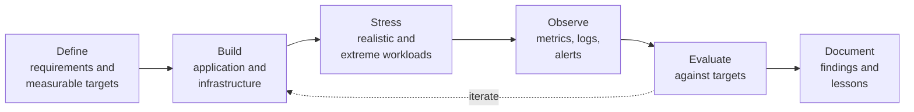
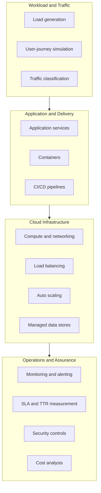

<div align="center">

# IIT Patna Projects

**An engineering workspace for cloud computing: build real systems, test them under pressure, and publish the evidence.**


[Overview](#overview) &nbsp;|&nbsp; [Principles](#engineering-principles) &nbsp;|&nbsp; [Workflow](#how-every-project-is-run) &nbsp;|&nbsp; [Domains](#technical-domains) &nbsp;|&nbsp; [Repositories](#repository-index) &nbsp;|&nbsp; [Standards](#repository-standards) &nbsp;|&nbsp; [Maintainer](#maintainer)

</div>

---

## Overview

IIT Patna Projects is the central organization for all repositories created during the **Executive M.Tech in Cloud Computing** program at **IIT Patna**. Course projects, mini-projects, experiments, study material and research work are kept here under one consistent structure, instead of being scattered across personal accounts.

The organization exists to answer one question for every piece of work in it:

> **Does this system actually behave the way we say it does?**

Cloud computing is easy to describe and harder to demonstrate. A system is only "scalable", "available" or "secure" if it can be shown with measurements, so each project here is expected to define its targets, test against them and report what happened, including what did not work.

---

## At a glance

| | |
|---|---|
| **Scope** | Cloud architecture, deployment, scaling, reliability, observability and security |
| **Output** | Working systems, reproducible experiments, documented results |
| **Approach** | Build, load, measure, document |
| **Cloud platform** | Amazon Web Services |
| **Delivery** | Containerized, infrastructure defined as code |
| **Visibility** | Public, open to review and feedback |

---

## Engineering principles

**1. Evidence over claims.**
Every quality attribute (availability, latency, scalability, recovery time) is stated as a measurable target and checked against real test results.

**2. Reproducibility.**
Anyone should be able to rebuild an environment and rerun an experiment from the repository alone, using containers and infrastructure as code.

**3. Realistic workloads.**
Systems are exercised with traffic that resembles real usage (user journeys, bursts, sustained load, automated clients) rather than synthetic one-line requests.

**4. Operate what you build.**
Monitoring, alerting and recovery procedures are part of the project, not an afterthought.

**5. Responsible testing.**
Load and security tests target only systems owned by this organization, using synthetic data and accounts.

**6. Cost awareness.**
Budgets and alerts are configured before deployment, capacity is kept minimal, and resources are removed once an experiment ends.

**7. Honest reporting.**
Failed experiments, missed targets and limitations are documented alongside successes.

---

## How every project is run

Each repository follows the same lifecycle, so results are comparable across projects.



| Stage | Question it answers |
|-------|---------------------|
| Define | What must the system achieve, and how will we know? |
| Build | What is the simplest design that can meet the targets? |
| Stress | What happens under normal load, peak load and failure? |
| Observe | What is the system doing right now, and why? |
| Evaluate | Did it meet the targets, and by what margin? |
| Document | What would someone need to reproduce and learn from this? |

---

## Technical domains

Work in this organization spans the layers of a modern cloud system.



| Domain | Topics |
|--------|--------|
| **Architecture** | Cloud design patterns, delivery models, virtualization, edge and serverless computing |
| **Deployment** | Containers, infrastructure as code, CI/CD, deployment policies |
| **Reliability** | SLAs, scaling policies, load balancing, failure and recovery testing |
| **Observability** | Metrics, dashboards, logging, alerting, incident tracking |
| **Security** | Access control, traffic filtering, rate limiting, bot recognition |
| **Economics** | Right-sizing, cost modeling, budget controls |

---

## Repository index

| Repository | Type | Description | Status |
|------------|------|-------------|--------|
| [`advanced-cloud-computing`](https://github.com/IIT-Patna-Projects/advanced-cloud-computing) | Project | Cloud engineering project centered on ShopScale, an e-commerce platform used to study deployment policies, auto scaling, monitoring and bot detection on AWS | `In development` |

This index is updated whenever a repository is added or changes state.

**Status definitions**

| Status | Meaning |
|--------|---------|
| `Planned` | Scope defined, work not started |
| `In development` | Actively being built or tested |
| `Complete` | Targets evaluated and results documented |
| `Archived` | Retained for reference, no longer maintained |

**Repository types:** `Project` end-to-end builds, `Assignment` course deliverables, `Experiment` benchmarks and studies, `Notes` study material, `Tooling` reusable scripts and templates, `Research` write-ups and reviews.

---

## Repository standards

Every repository is expected to contain the following, so any project can be understood and run in minutes.

```text
repository/
├── README.md        Purpose, architecture, setup, results
├── LICENSE          Usage terms
├── docs/            Design decisions, test plans, reports
├── infrastructure/  Infrastructure as code
├── tests/           Functional and workload tests
├── .env.example     Required configuration, with no secrets
└── .gitignore
```

| Area | Standard |
|------|----------|
| **Naming** | Lowercase, hyphen-separated, descriptive |
| **Commits** | Conventional prefixes: `feat`, `fix`, `docs`, `test`, `chore` |
| **Secrets** | Never committed; configuration supplied through environment variables |
| **Documentation** | Setup instructions verified from a clean checkout |
| **Results** | Experiment methodology, raw numbers and conclusions recorded in `docs/` |

---

## Technology landscape

| Category | Technologies |
|----------|--------------|
| Cloud | AWS (EC2, ALB, Auto Scaling, RDS, S3, CloudWatch, ECR, IAM, WAF) |
| Containers and delivery | Docker, Docker Compose, Jenkins, GitHub Actions |
| Infrastructure as code | Terraform |
| Languages | Python, TypeScript, JavaScript |
| Data | PostgreSQL, MySQL |
| Testing | Playwright, Locust, pytest |
| Observability | Prometheus, Grafana, CloudWatch |

Tools are chosen to solve a demonstrated problem, not for novelty.

---

## Maintainer

**Priyanshu Kumar Sharma** is a B.Tech Information Technology graduate and a first-year Executive M.Tech (Cloud Computing) student at IIT Patna, based in Pune. He works across cloud technology, information security and research-driven systems, with industry experience in CI/CD and containerization and research experience in serverless computing and FaaS benchmarking at IIT Ropar.

| | |
|---|---|
| **Focus** | Multi-cloud orchestration, serverless benchmarking, IAM and Zero Trust, cloud automation |
| **Cloud and DevOps** | AWS, Azure, GCP, Terraform, Pulumi, Docker, Kubernetes, Jenkins, Ansible |
| **Languages** | Python, JavaScript, Java, Bash |
| **Credentials** | Certifications from AWS, Oracle, Fortinet and Zscaler; peer-reviewed publication on cloud orchestration (IJCRT) |

<div align="center">

### Connect

<a href="https://github.com/itspriyanshuks17"></a>
<a href="https://priyanshuksharma.github.io/PriyanshuKSharma/"></a>
<a href="https://www.linkedin.com/in/priyanshu-kumar-sharma-333800251"></a>
<a href="https://hub.docker.com/u/priyanshuksharma"></a>

<sub>GitHub for code &nbsp;|&nbsp; Portfolio for projects &nbsp;|&nbsp; LinkedIn for professional contact &nbsp;|&nbsp; Docker Hub for container images</sub>

</div>

---

## Contributing

Feedback, corrections and ideas are welcome.

1. Open an issue in the relevant repository describing the suggestion or problem.
2. For changes, fork the repository and create a branch.
3. Submit a pull request that explains what changed and how it was tested.

---

<div align="center">

**Define. Build. Stress. Observe. Document.**

</div>
